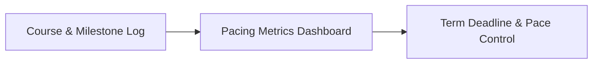
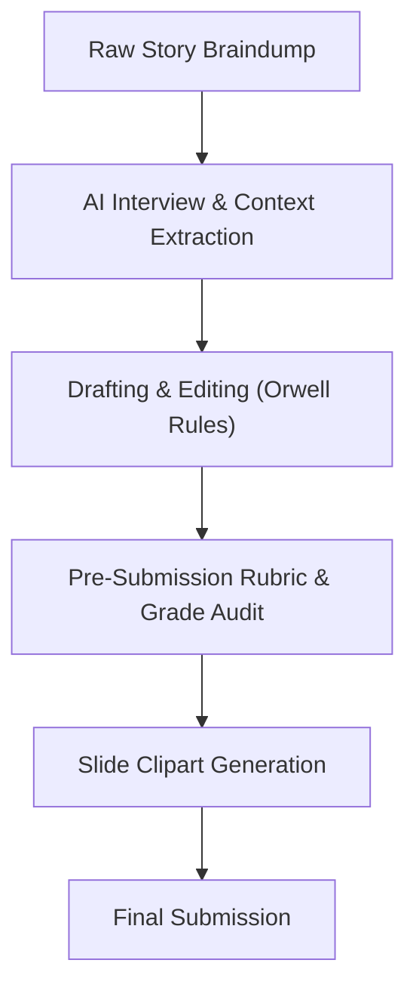

# UMPI YourPace Course Execution Guide
*A Systematic Blueprint for Navigating, Structuring, and Completing Self-Paced Courses in UMPI YourPace*

---

## Overview & Hard Disclaimer: Who This Guide Is (and Is Not) For

This guide provides a systematic, end-to-end blueprint for navigating, structuring, and rapidly completing coursework in the **UMPI YourPace** Competency-Based Education (CBE) program.

> [!WARNING]
> **CRITICAL REALITY CHECK: CBE IS COMPETENCY VERIFICATION, NOT TRADITIONAL TEACHING**  
> Competency-Based Education (CBE) is designed specifically for **experienced adult professionals** who already possess real-world operational, managerial, or technical knowledge. As UMPI officially states in its YourPace program guidelines:
> 
> > *"In a competency-based education program, your success rests upon your ability to demonstrate proficiency of knowledge and skills... [allowing] students to move through content at their own pace, **especially when they are able to apply previous educational, professional, and/or life experiences to assessments**. While student support is always at the forefront... **consistent and synchronous instructional support is not an expectation in the YourPace program**, due to the intentional design of the competency-based modality."* — **UMPI YourPace Policy**
> 
> * **Why Experience is Mandatory**: In every written assignment across every class, professors expect you to synthesize academic concepts with authentic, lived workplace experience. If you lack real-world experience, your papers will sound detached, mechanical, and fail to meet exemplary rubric standards.
> * **No One Is Here to Teach You Step-by-Step**: As UMPI explicitly notes, there is no expectation of synchronous instruction. If you expect professors to deliver traditional lectures or guide you through foundational concepts from scratch, **you are in the wrong program and wasting your money**.
> * **Recommendation for Inexperienced Students**: If you do not have a solid foundation of professional experience to draw from, withdraw from YourPace and enroll in a traditional classroom program where material is taught step-by-step.

---

## About the Author

Hi! My name is **Christopher Thompson** (known on Discord and Reddit as **`Bigcjat`**).

### My Journey Through UMPI YourPace
I initially set out to earn a Bachelor of Liberal Studies (BLS) through UMPI YourPace simply to satisfy a visa requirement. Shortly after starting, a classmate challenged me to tackle the full **Bachelor of Business Administration (BBA)** instead. At first, I obsessed over the idea that it was impossible—it required 19 university courses instead of 10. 

However, as I built and refined the systematic execution method detailed in this guide, I found that not only was it possible, but I finished the entire BBA with time left over in the term and several multi-day breaks along the way. 

I have now completed both my **Bachelor of Business Administration (BBA)** and my **Master of Arts in Organizational Leadership (MAOL)** through UMPI YourPace (having submitted my final capstone) by executing the exact systematic framework detailed in this guide. Following the MAOL, my plan is to continue into the **MS in Business Intelligence**.

### Professional & Background Context
* **Oil & Gas Operations**: 20 years in the oil and gas industry, including 11 years as an operational field foreman for a producer on the British Columbia / Northwest Territories border in Canada.
* **Software Engineering & Tech**: Developer in JavaScript, Python, and PHP for ~25 years. I first went to college in 2001 for a Network Diploma specializing in Windows 2000 and worked briefly at Yahoo!.
* **Location & Lifestyle**: I currently live in Asia, traveling between Tokyo, Singapore, Hanoi, Taiwan, and South Korea.

---

## Table of Contents
* **[Part 1: Degree Planning & Transfer Credit Optimization](#part-1-degree-planning--transfer-credit-optimization)**
  * [The Catalog Lock-in Strategy](#the-catalog-lock-in-strategy-why-you-must-apply-today)
  * [Leveraging Free Resources: Plotted Path](#leveraging-free-resources-plotted-path)
  * [Addressing Transfer Credit Anxiety (Graduate Strategy)](#addressing-transfer-credit-anxiety-the-graduate-degree-strategy)
  * [Protecting Your ACE Credits (Sophia & Study.com Hygiene)](#protecting-your-ace-credits-avoiding-account-suspensions-on-sophia--studycom)
  * [The "Chipotle Degree" Trap (Avoid the BLS & Reconsider MAOL)](#the-chipotle-degree-trap-avoid-the-bls--reconsider-defaulting-to-the-maol)
* **[Part 2: Proactive Professor Selection & Community Research](#part-2-proactive-professor-selection--community-research)**
  * [Leverage Community Reviews (Discord & Reddit)](#1-leverage-community-reviews-discord--reddit)
  * [How to Lookup Available Professors (MaineStreet)](#2-how-to-lookup-available-professors-mainestreet-class-search)
  * [Active Course Limits & The "Final Sent" Acceleration Hack](#3-active-course-limits--the-final-sent-acceleration-hack)
  * [What to Do When a Professor Doesn't Grade on Time (72-Hour Protocol)](#4-what-to-do-when-a-professor-doesnt-grade-on-time-the-72-hour-protocol)
  * [Contacting the Program Director for Unresolved Issues](#step-3-persistent-friction-or-administrative-blockers-contact-the-program-director)
* **[Part 3: Macro Level — Pacing & Progress Tracker](#part-3-macro-level--umpi-yourpace-pacing--progress-tracker-spreadsheet-system)**
  * [Master Pacing Spreadsheet Schema](#master-pacing-spreadsheet-schema)
  * [Academic Calendar Deadlines & Academic Standing Risks](#academic-calendar-deadlines--academic-standing-risks)
* **[Part 4: Micro Level — Course Workspace Architecture](#part-4-micro-level--course-workspace-architecture--organization)**
  * [Standardized Course Directory Structure](#standardized-course-directory-structure)
  * [Mandatory APA 7 Standard & Plain-Text First Drafting](#mandatory-apa-7-standard--drafting-strategy)
  * [Submitting Final Drafts First](#mandatory-apa-7-standard--drafting-strategy)
* **[Part 5: The Core Human Execution System (Non-AI Workflow)](#part-5-the-core-human-execution-system-non-ai-workflow)**
  * [Step 1: Syllabus & Professor Information Setup](#step-1-syllabus--professor-information-setup)
  * [Step 2: Source Extraction & Video Subtitles](#step-2-source-extraction--video-subtitles)
  * [Handling Broken Links, Paywalls & Course Material Citations](#handling-broken-links-paywalls--course-material-citations)
  * [Step 3: The Lived-Experience Braindump](#step-3-the-lived-experience-braindump)
  * [Step 4: The 8-Source Reference Selection System](#step-4-the-8-source-reference-selection-system)
  * [Step 5: Plain English Writing & Orwell’s 6 Rules](#step-5-plain-english-writing--orwells-6-rules)
* **[Part 6: Responsible & Authorized AI Integration](#part-6-responsible--authorized-ai-integration)**
  * [Professor-Specific Policies & Ethical Guidelines](#part-6-responsible--authorized-ai-integration)
  * [Interactive Context Interviews](#1-interactive-context-interviews-refining-your-braindump)
  * [Automated Rubric & Professor Grading Simulation](#2-automated-rubric--professor-grading-simulation-finding-holes-before-submission)
  * [90s Minimalist Clipart Generation](#3-presentation-asset-generation-why-90s-minimalist-ai-clipart)
  * [Slide Simplicity & Speaker Notes Protocol](#4-slide-simplicity-dont-jam-information-onto-the-slide)
  * [Cameo Video Recording & Presentation Confidence](#5-cameo-video-recording--presentation-confidence)
* **[Part 7: Student Mindset, Motivation & Burnout Strategies](#part-7-student-mindset-motivation--burnout-strategies)**

---

## Part 1: Degree Planning & Transfer Credit Optimization

> [!IMPORTANT]
> **Scope Disclaimer: This is NOT a Transfer Credit Guide**  
> This guide is strictly focused on the **UMPI YourPace course execution workflow**. It assumes you have already maximized all possible third-party transfer credits (Sophia, Study.com, StraighterLine, Coursera) prior to starting your residency at UMPI.  
> 
> **Do NOT Trust Google, ChatGPT, or AI for Degree Planning**: Transfer equivalencies, General Education Curriculum (GEC) rules, and course residency requirements change frequently. Relying on outdated blog posts, random Google searches, or AI chatbots to build your degree plan will leave you with missing prerequisites, unfulfilled requirements, and unexpected gaps in your plan.

Before starting your UMPI YourPace term, maximize your transfer credits to minimize cost and time spent in residency. 

### The Catalog Lock-in Strategy: Why You Must Apply Today

UMPI frequently updates its degree programs, General Education Curriculum (GEC) requirements, and third-party transfer equivalencies. A policy change can happen mid-year, instantly invalidating planned transfer courses or adding new requirements.

* **Apply Immediately**: Do not wait until you have finished all your Sophia or Study.com courses before submitting your UMPI application. Apply for the very next available session today.
* **The Power of Deferral**: Applying locks you into the current academic catalog and transfer rules. If you aren't ready to start classes when that session arrives, you can simply contact admissions and defer your start date to a future term without losing your catalog lock.
* **Avoid Wasted Effort**: Locking in your catalog year prevents you from spending three to six months grinding out credits on third-party platforms only to discover that a curriculum overhaul derailed your entire degree plan. The best time to apply is right now.

### Leveraging Free Resources: Plotted Path
* **Free Degree Planning Resource**: Visit **[plottedpath.com/free](https://www.plottedpath.com/free)** for comprehensive, up-to-date transfer equivalency charts and General Education (GEC) mapping sheets specifically for UMPI YourPace.
* **Transfer Provider Mapping**: Plotted Path maintains exact equivalency breakdowns showing which courses transfer into UMPI YourPace degree programs from third-party platforms (**Sophia, Study.com, StraighterLine, Coursera**) versus which courses are **UMPI Only**.
* **Community Guidance**: The creator of Plotted Path (`whimsicalone` / Plotted Path ✨) is active in the UMPI YourPace student Discord community, regularly answering student questions on course planning and minor combinations.
* **Custom Degree Plans**: For students with complex prior credits or specific timeline targets, Plotted Path offers personalized, custom degree mapping services for a fee—well worth the investment to optimize your transfer strategy before enrolling.

### Addressing Transfer Credit Anxiety: The Graduate Degree Strategy

> [!TIP]
> **THE GRADUATE DEGREE "CREDIT CLEANSING" STRATEGY (Employers & Immigration)**  
> **Worrying that having 75%+ of your degree transferred from Sophia and Study.com looks bad?**  
> If you plan to continue directly into a master's program (such as UMPI’s **MAOL** or **MS in Business Intelligence**), employers and immigration authorities will evaluate your **highest degree earned**, rendering underlying transfer credit volume irrelevant.

A common anxiety among CBE students is whether transferring 90 credits from third-party platforms like **Sophia.org** and **Study.com** will hurt their credibility with traditional employers, background check agencies, or international visa officers (e.g., for work visas in Japan, Europe, or the US).

#### The Hierarchy of Credential Evaluation
1. **The Highest Degree Dominates**: In corporate hiring and background screening, employers evaluate your *highest level of completed education*. Once you list a Master's degree on your resume, hiring managers rarely ask for your undergraduate transcripts, let alone audit ACE transfer credits.
2. **Immigration & Work Visa Processing**: Immigration authorities evaluate institutional accreditation (Regionally Accredited / NECHE) and degree level. A Master's degree from a public state university satisfies degree requirements for foreign work visas instantly without officers parsing third-party transfer providers from years prior.
3. **Cost-Effective Credential Stacking**: Using Sophia/Study.com allows you to finish your bachelor's in record time for under $3,000. Transitioning straight into a UMPI master's program gives you a graduate title for minimal extra cost and time, permanently erasing any perceived stigma attached to undergraduate transfer volume.

---

### Protecting Your ACE Credits: Avoiding Account Suspensions on Sophia & Study.com

A frequent complaint across student communities is sudden account suspensions or flagged submissions on platforms like Sophia.org and Study.com. Because these platforms have faced increasing scrutiny from universities and accreditors, they have deployed aggressive, automated detection systems to flag potential cheating. 

First and foremost: **do not cheat**. Third-party ACE credits transfer into UMPI strictly as Pass/Fail (`P/F`). There are no letter grades, no GPA impact, and zero reason to risk your academic record by cutting corners. 

While many online complaints come from people who were legitimately caught cheating, innocent students also get swept up by crude automated heuristics. Protect yourself by following strict operational hygiene:

1. **Use a Clean Browser Profile (Zero Extensions)**:
   * Create a dedicated, clean browser profile with **all browser extensions disabled**.
   * Anti-cheating scripts monitor browser environments, but their detection methods are clumsy. An innocent color picker, tab manager, audio equalizer, or dark mode extension can easily trigger a false flag.
2. **Stick to Standard Mainstream Browsers**:
   * Use standard browsers: **Google Chrome, Chromium, Mozilla Firefox, Microsoft Edge, or Opera**.
   * Avoid privacy-focused, shield-heavy, or obscure browsers like **Brave, Tor/Onion, or Turtle**. Their built-in ad-blocking, script-blocking shields, and fingerprinting protections can break platform telemetry and look suspicious to automated monitoring.
3. **Maintain Strict Window Focus & Single Tabs**:
   * Keep only one tab open while logged into an assessment.
   * Maintain focus on the browser window the entire time. Do not alt-tab, switch to other applications, or leave the test screen idle.
4. **No VPNs, Multiple Devices, or Screenshots**:
   * **No VPNs or Proxies**: Sudden IP location changes trigger immediate fraud and account-sharing flags.
   * **Single Device Only**: Never log into the platform from a phone or second computer while an exam session is active.
   * **Never Take Screenshots**: Avoid using snippet tools, print-screen keys, or screen capture software while inside course modules.
5. **Treat Every Module Like a Proctored Exam**:
   * Even when an assessment does not require a webcam, act as if you are being actively proctored. Building clean, disciplined study habits on third-party platforms ensures you never carry risky habits into your actual university coursework.
6. **Claim Credly Badges Immediately After Every Course**:
   * Do not let finished course credits sit uncollected inside Sophia or Study.com. As soon as you complete a course, immediately accept and claim your official ACE digital badge in **Credly**.
   * Credly is an independent third-party credential registry. Once a badge is claimed in Credly, it is permanently locked into your official transcript. If your learning platform account ever runs into an unexpected administrative freeze, false flag, or dispute, your already-claimed Credly transcript remains secure and can still be officially sent directly to UMPI.

---

### The "Chipotle Degree" Trap: Avoid the BLS & Reconsider Defaulting to the MAOL

A common debate across YouTube, Reddit, and Discord is students trying to optimize for the absolute minimum number of courses, often choosing paths that hurt them long-term.

> [!WARNING]
> **THE GOLDEN RULE OF DEGREE SELECTION**:  
> *If someone had to sell it to you as a good idea, you will forever have to sell it to others.*  
> CBE gives you massive shortcuts, but you should use those shortcuts to walk away with a **better, higher-value degree**—not a sub-par compromise.

#### 1. The BLS ("Chipotle Degree") Trap
People online constantly try to sell the **Bachelor of Liberal Studies (BLS)** like it is a smart shortcut, claiming *"it checks the same box"* or *"if you get a master's later, your undergrad degree doesn't matter anyway."*

**This is a trap.** 

Saving a handful of courses is not worth the long-term disadvantage. For the rest of your career, you will either have to constantly explain to recruiters that your BLS was not an unfocused liberal arts degree, or forever wonder if hiring managers filtered your resume out in favor of candidates holding a standard Bachelor of Business Administration (BBA) or Bachelor of Science (BS). Do the extra coursework and graduate with a real, recognized business credential.

#### 2. The MAOL Trap vs. The Master of Science in Business (MSB)
The exact same shortcut trap happens at the graduate level. Students frequently rush into the **Master of Arts in Organizational Leadership (MAOL)** solely because you can roll up 3 to 4 courses from your UMPI undergrad, making it look like the easiest and fastest master's degree.

Unless an MAOL aligns specifically with your exact career target, blindly defaulting to it is a mistake:
* **Look at the MSB (Master of Science in Business)**: The MSB offers targeted, marketable concentrations (such as **Supply Chain Management**, **Project Management**, and **Healthcare Administration**). It is a far more respected, specialized graduate degree for the exact same tuition price.
* **You Can Still Roll Up Courses**: Depending on your chosen MSB concentration, you can still roll up 1 to 2 courses from your undergrad, keeping your timeline short.
* **Superhuman Grading Support (e.g., Dr. Michael Curran)**: In the Supply Chain concentration, the courses are taught by **Dr. Michael Curran**. If you are a capable writer with real workplace experience, completing this concentration is smooth and fast because Dr. Curran is an exceptionally supportive professor with superhuman grading turnaround times.
* **Curriculum Boredom in the MAOL**: If you already completed a BBA or business coursework at UMPI, the MAOL curriculum becomes repetitive and boring. You will find yourself writing about the exact same leadership concepts and case studies on repeat, making it difficult to stay engaged.

Take advantage of CBE's accelerated pacing to earn a powerful, specialized credential rather than settling for an easy title you will spend years defending.

---

## Part 2: Proactive Professor Selection & Community Research

One of the single most effective strategies in UMPI YourPace is spending **10 minutes researching and requesting specific professors** before adding a course. 

While core assignment prompts and rubrics remain identical regardless of who teaches the class, professor grading turnaround speed, feedback depth, and evaluation style vary significantly. Selecting a professor who aligns with your pace and communication style can save days of waiting time per course.

### 1. Leverage Community Reviews (Discord & Reddit)

> [!TIP]
> **Professor Selection Hack**: Content is standardized across all sections, but securing a professor who grades efficiently keeps your momentum going without administrative bottlenecks. Before requesting a section, check student feedback:
> * **[UMPI Student Discord Community](https://discord.gg/P6HnsZ8CdQ)**: Access dedicated review channels:
>   * **`#professor-reviews`**: Read feedback on grading turnaround times (e.g., 24-hour graders vs. multi-day turnaround), accommodating communication, and grading fairness.
>   * **`#class-reviews`**: Review overall course difficulty, number of milestone activities, and specific professor recommendations for that exact class.
> * **[r/UMPI Subreddit](https://www.reddit.com/r/UMPI/)**: Search the official student subreddit for course completion reports, transfer strategies, professor insights, and degree planning advice.

---

### 2. How to Lookup Available Professors (MaineStreet Class Search)

Follow these exact steps to see which professors are teaching upcoming UMPI YourPace course sections:

1. Log into **`mycampus.maine.edu`**.
2. Under **Category Links**, click **Mainestreet** $\rightarrow$ **Classic Student Center**.
3. Click the **House icon** at the top right (next to the bell icon).
4. In the top search bar, type **`class search`** (*do NOT press enter*).
5. Click **"Class Search Curriculum Management"** from the pop-up results.
6. Set **Institution** to *University Maine Presque Isle*.
7. Set **Term** to your active term (e.g., *2026 Summer* or *2026 Fall*).
8. Set **Session** to *OnlineMaine Session 01* (YourPace Session 1) or *OnlineMaine Session 02* (YourPace Session 2).
9. Click **Search**. Scroll through the alphabetized course list to inspect active sections and view the assigned professor for each section.

> [!NOTE]
> **Requesting Your Preferred Professor**: When emailing to add your next competency (`umpi-addcompetency@maine.edu`), explicitly request your preferred professor by name.

---

### 3. Active Course Limits & The "Final Sent" Acceleration Hack

Understanding UMPI's concurrent course limits and the course addition mechanic prevents you from losing days of momentum:

* **Active Course Concurrency Limits**:
  * **Undergraduate (4 Course Cap)**: You begin the term registered in 2 courses. You can immediately email `umpi-addcompetency@maine.edu` on Day 1 to add 2 more courses, bringing you to your 4-course maximum.
  * **Graduate (2 Course Cap)**: Capped strictly at 2 active courses at a time.

* **The "Final Sent" Acceleration Hack (Never Wait for Final Grades)**:
  * A common mistake students make is waiting for a professor to review and grade their Final Assessment before requesting their next class. **Never do this.**
  * The second you submit a Final Assessment in Brightspace, you receive an automated submission confirmation email.
  * **Forward that confirmation email directly** to `umpi-addcompetency@maine.edu` along with your request for the next course (specifying the course code and your preferred professor).
  * UMPI treats a "Final Sent" as course completion for registration purposes. It immediately clears that course from your active cap (freeing up a slot in your 4-course undergrad or 2-course grad limit) so your next course is unlocked without waiting on professor grading turnaround.

---

### 4. What to Do When a Professor Doesn't Grade on Time (The 72-Hour Protocol)

Bottlenecks happen. When an instructor exceeds their turnaround window, understand the exact rules and execute a clean follow-up:

* **The Grading Window**: **72 hours straight** — this **includes weekends and holidays**. The 72-hour timer runs 24/7 from the exact timestamp of your submission.
* **The Email Response Window**: **24 hours** — this **excludes weekends and holidays** (business days only).

#### Step 1: Send the 72-Hour Direct Inquiry
Once 72 hours have elapsed without a grade, email the professor directly at their university email. Keep the message short, factual, and focused on course progression:

```text
Subject: Grade Inquiry: [Course Code] - [Assignment Name] (Student ID: [Your ID])

Hi [Professor Last Name],

I am writing to check in on my submission for [Course Code, e.g., BUS 353] - [Assignment Name, e.g., Milestone 2], submitted on [Date & Time]. 

It has now passed the 72-hour grading window, and I would like to review your feedback so I can continue making progress in the course.

Thank you,
[Your Name]
[Student ID]
```

#### Step 2: The 24-Hour Coach Escalation
The professor has 24 business hours (excluding weekends and holidays) to reply to your inquiry. 

If that 24-hour window passes with zero response:
1. **Re-send the exact same email thread.**
2. **CC your assigned Academic Coach.**

Your academic coach is your direct operational advocate inside UMPI. Placing them on the thread formally alerts the university that an instructor is unresponsive and stalling your degree progress, prompting internal administrative follow-up without you needing to argue.

#### Step 3: Persistent Friction or Administrative Blockers? Contact the Program Director

If you experience unresolved communication issues or persistent friction with a professor, coach, or advisor, do not waste time complaining on Reddit or Discord. Venting in student forums will not resolve your problem.

Instead, look up the **current YourPace Program Director** on the UMPI directory and email them directly:
* **Approachable and Responsive**: In my direct experience reaching out to program leadership, the director is very responsive, approachable, and actively works to rectify legitimate student issues.
* **Actual Authority to Fix Problems**: Unlike online chat groups, the program director has the administrative authority to intervene, contact department chairs, resolve grading disputes, and unblock operational stalls.
* **Keep It Professional and Factual**: Forward the relevant email chain with a concise, respectful summary of the dates, course numbers, and steps you have already taken. Factual, professional communication gets immediate results.

---

## Part 3: Macro Level — UMPI YourPace Pacing & Progress Tracker (Spreadsheet System)

While local folders handle individual course files, a **Macro Pacing Spreadsheet** gives you total visibility over your entire UMPI YourPace degree plan, term deadlines, and milestone progress.



Below is the **essential minimum tracking schema** every UMPI YourPace student should maintain:

### Master Pacing Spreadsheet Schema

| Tracking Field | Data Tracked | Operational Rationale |
| :--- | :--- | :--- |
| **1. Course Identifiers** | Course Code (e.g., `BUS 353`), Title, Credit Hours, Platform | Prevents confusion between similar courses (e.g., `BUS 240` vs. `BUS 245` vs. `BUS 415`) and tracks transfer credit sources. |
| **2. Granular Status** | `Started`, `Draft Sent`, `Final Sent`, `Complete`, `Transferred` | Color-coded status fields give an instant visual check of what is active vs. waiting on professor review. |
| **3. Milestone Columns** | Separate columns for `M1`, `M2`, `M3`, `M4`, `M5`, `Final Draft`, `Final` | Identifies the exact bottleneck in any course so you know whether you are waiting on M2 or ready for the Final. |
| **4. Submission Timers** | Submission Timestamp (`Aug 1, 15:08`) & Elapsed Time Calculator | Tracks professor grading windows and alerts you when a submission has exceeded standard turnaround times. |
| **5. Term Clock Metrics** | Days Elapsed vs. Days Remaining in current 8-week term | Seeing **"27 Days Remaining"** alongside **"4 Courses Left"** calculates required pace (e.g., 6.7 days/course). |
| **6. Hard Cutoff Dates** | Course Add Cutoff, Milestone Cutoff, Final Submission Cutoff | Prevents missing administrative deadlines that block unlocking your next course section. |
| **7. Professor Notes** | Grading velocity (*"Grades in 24 hrs"* vs. *"Takes 3 days"*) | Allows strategic submission sequencing—submitting to a fast grader right before a weekend eliminates downtime. |

---

### Academic Calendar Deadlines & Academic Standing Risks

You must download and strictly adhere to the official **[2026–2027 UMPI YourPace Academic Calendar](https://www.umpi.edu/academics/wp-content/uploads/sites/19/2026/06/2026-2027-YourPace-Academic-Calendar.pdf)**. 

In a self-paced program, it is easy to become complacent, but the university enforces hard, non-negotiable cutoffs:
* **Course Add Deadline**: The final day to add an initial course load or request an additional course section from your coach.
* **Milestone Submission Cutoff**: Typically Tuesday at 11:59 PM EST of the final week of the session. Milestones submitted after this cutoff will not be evaluated in time for you to submit your final assessment.
* **Final Assessment Cutoff**: The final Friday of the session at 11:59 PM EST.

#### The Downstream Cost of Missed Deadlines
Missing a deadline is not just an administrative hiccup—it can severely derail your degree plan and finances:
* **Automatic Incompletes & Failing Grades**: Missing milestone or final cutoffs leads to an administrative withdrawal (`W`) or course failure (`F`), which is permanently recorded on your academic transcript.
* **The Non-Degree Seeking Term Trap**: If a failing grade drags your cumulative GPA below the minimum threshold (2.0 for undergraduate or 3.0 for graduate programs), you face academic probation or suspension. Recovering from suspension often requires enrolling in a **non-degree seeking term** solely to raise your GPA before you can be formally readmitted into your degree program.
* **Compounded Time and Financial Expense**: A non-degree term means paying out-of-pocket for extra tuition, losing months of forward momentum, and facing intense academic pressure just to regain your enrolled status.

Download the academic calendar on Day 1 of every term and plug every hard deadline directly into your macro pacing spreadsheet.

---

## Part 4: Micro Level — Course Workspace Architecture & Organization

By adopting a **Clean Module Directory Architecture**, you keep your thoughts organized, reduce cognitive friction, and eliminate wasted time hunting for misplaced files.

### Standardized Course Directory Structure

For every course, create a dedicated directory structured as follows:

```text
/Course_Name (e.g., OLS 500 Data Driven)
├── sources.txt                 <-- Central master stash of all citations & APA 7 references
├── mod 1/                      <-- Module 1 folder
│   ├── mod1.txt                <-- Local plain-text copy of assignment prompt & rubric
│   ├── course materials/       <-- PDFs, readings, articles, & textbook chapters for Mod 1
│   ├── srts/                   <-- Downloaded .srt video subtitle files for Mod 1
│   ├── Milestone_1.txt         <-- Working draft file for Milestone 1
│   └── Milestone_1.docx        <-- Final formatted submission file
├── mod 2/                      <-- Module 2 folder
│   ├── mod2.txt                <-- Local plain-text copy of assignment prompt & rubric
│   ├── course materials/       <-- PDFs, readings, articles, & textbook chapters for Mod 2
│   ├── srts/                   <-- Downloaded .srt video subtitle files for Mod 2
│   ├── Milestone_2.txt         <-- Working draft file for Milestone 2
│   └── Milestone_2.docx        <-- Final formatted submission file
└── final/                      <-- Final Assessment folder
    ├── Final_Submission.txt    <-- Working draft file for Final Assessment
    └── Final_Submission.docx   <-- Final formatted submission file
```

---

### Key Directory Protocols

> [!NOTE]
> **1. The "Prompt Inoculation" Method (`modX.txt`)**  
> Before typing a single word of a draft, copy the exact assignment prompt and rubric criteria from Brightspace into a local plain-text file (`mod1.txt`, `mod2.txt`). Your prompt criteria sit right next to your draft so you never switch tabs or hunt for rubrics while writing.

> [!NOTE]
> **2. Sub-Folder Organization: `course materials/` & `srts/`**  
> * **`course materials/`**: Holds all downloaded course PDFs, articles, reading assignments, and textbook chapters for that module.  
> * **`srts/`**: Holds all downloaded `.srt` video subtitle transcript files for that module's video lectures.

---

### Mandatory APA 7 Standard & Drafting Strategy

> [!IMPORTANT]
> **Mandatory APA 7 Standard (Stop Wasting Time Asking)**  
> * **Every Single Document is APA 7**: A common point of confusion among new UMPI students on Discord and Reddit is asking whether a specific milestone or final assignment requires APA 7 formatting. **Yes, it does — every single document submitted at UMPI YourPace requires APA 7 formatting.** Stop wasting time asking; simply treat APA 7 as the non-negotiable default for every paper, essay, and milestone across all courses.
> * **Gold-Standard APA 7 Reference**: Reference the official **[Purdue OWL APA 7 Formatting & Style Guide](https://owl.purdue.edu/owl/research_and_citation/apa_style/apa_formatting_and_style_guide/apa_sample_paper.html)** for sample papers, title page setups, in-text citations, and reference list formatting.

> [!TIP]
> **Plain-Text First Drafting Strategy (`.txt` to `.docx`)**  
> Some students prefer building pre-formatted Microsoft Word templates (`12 pt Times New Roman, double-spaced`) upfront. Personally, I hate writing inside double-spaced 12 pt Times New Roman from scratch—it slows down my train of thought.
> 
> * **Draft in Plain Text First**: Write all working drafts in simple plain-text (`.txt`). Drafting in plain text forces you to focus 100% on argument flow, thesis depth, and source citations without getting distracted by Word line spacing, font dropdowns, or margins.
> * **The Rapid Polishing Pass**: Once the draft is complete, copy the plain text into Microsoft Word and format it into APA 7 right before submitting. With practice, you get significantly faster—you can take an unformatted plain-text draft and turn it into a polished APA 7 document in just a few minutes. 
> * **The Hidden Benefit**: This final formatting pass forces you to read through your entire paper line-by-line one more time, catching typos, passive voice, and weak transitions right before submission.
> * **Do Whatever Works for You**: Whether you prefer starting from a Word template or using the plain-text-first method, choose whatever is easiest for you—just remember to stick strictly to APA 7 for every single document!

> [!TIP]
> **Automated Citation & Reference Management (Zotero)**  
> To automate collecting research papers, organizing citations, and building instant APA 7 reference lists across all your courses, install **[Zotero](https://www.zotero.org/)** (a free, open-source reference manager).
> 
> * **Degree Strategy Tutorial**: For a complete step-by-step walkthrough on setting up Zotero for UMPI courses, watch **[How to Use Zotero for Fast Academic Research](https://www.youtube.com/watch?v=fHQtAodgNrQ)** by **Melanie** from the **Degree Strategy** channel (a UMPI Bachelor's and Master's graduate). Her guide shows how to save web articles/PDFs with one click and auto-export formatted APA 7 citations straight into your papers.

> [!IMPORTANT]
> **Always Submit a Final Draft First (Never "YOLO" Your Final Assessment)**  
> Another constant point of confusion on Discord is students skipping draft submissions or ignoring professor feedback. Follow these non-negotiable submission rules:
> * **Always Submit a Draft First**: Never bypass the draft submission step for your Final Assessment.
> * **Address Every Bit of Feedback**: Unless your professor explicitly tells you to submit your draft directly as your final (meaning you scored perfect marks), **always address every single piece of feedback** before submitting the final version.
> * **Draft Scores Do NOT Guarantee Final Grades**: Even if you don't care about Latin Honors or perfect scores, receiving a 3/4 on a draft criterion does *not* guarantee a 3/4 if you re-submit it unedited as your final. Professors expect active revisions.
> * **Never "YOLO" a Final Essay**: Do not get cocky and submit a final without getting draft feedback first. Bypassing the feedback loop could annoy a professor, and your final score will likely reflect it. Just don't do it.

---

## Part 5: The Core Human Execution System (Non-AI Workflow)

### Step 1: Syllabus & Professor Information Setup

Before writing a single sentence, open the **Syllabus / Welcome tab** in your Brightspace portal and read it from top to bottom.

> [!TIP]
> **Record Professor Details in Your Tracker Immediately**: The Syllabus tab provides two essential pieces of information to record in your course tracking spreadsheet on Day 1:
> * **Professor's Exact Name**: You need their correct name and formal title immediately because it must appear on the APA 7 title page of every milestone paper, presentation, and final assessment.
> * **Professor's University Email**: Keep their direct email handy in your tracker so you can quickly reach out if you need clarification on an ambiguous assignment prompt or specific grading feedback.

* **Map the Course Arc**: Identify every milestone assignment, knowledge check, and the final project/essay requirement upfront.
* **Select an Overarching Topic Early**: Pick a single, robust research topic or real-world operational scenario during Module 1 that can thread directly through every milestone into the final project.
* **Cumulative Stacking (Building the Final as You Go)**: Re-using a consistent operational theme means Milestones 1–5 serve as building blocks. By the time you reach the Final Assessment, 70% of your research, references, and core arguments are already written.

---

### Step 2: Source Extraction & Video Subtitles

Maximize learning and eliminate note-taking during lectures.

* **Watch Assigned Videos for Deep Context**: Video lectures and talks provide far richer context and better conceptual understanding than dry textbook readings alone. Watch them to absorb the core ideas.
* **Download Video Subtitles (`.srt`) into `mod X/srts/`**: Use free transcript tools (e.g., DownSub) to download the `.srt` subtitle files for every course video directly into that module's `srts/` folder.
* **Save Readings into `mod X/course materials/`**: Save all PDF articles, chapters, and required readings into the module's `course materials/` folder.
* **Zero Note-Taking While Watching**: Do not pause videos to write manual notes. Sit back and focus entirely on watching and understanding the material. The `.srt` files in your `srts/` folder serve as your complete, word-for-word transcript, allowing you to search for exact quotes, timestamps, and key terms later when drafting your assignments.
* **Centralize Citations in `sources.txt`**: Use `sources.txt` at the root of the course folder strictly to stash master APA 7 bibliographic citations for all readings and videos.

#### Handling Broken Links, Paywalls & Course Material Citations

A frequent issue in Brightspace is clicking an assigned reading only to hit a 404 error, a dead link, or an aggressive paywall. Never buy articles out of pocket, and don't stall your momentum waiting for professor emails. Furthermore, **official APA 7 rules specifically advise against linking readers to paywalls or subscription gates**. If an article cannot be freely retrieved, citing a locked URL is poor academic practice. 

Triage your sources using these methods:

1. **The Wayback Machine (Archive.org)**:
   * Paste the broken URL into [web.archive.org](https://web.archive.org/) and select an active snapshot. In your reference list, provide the standard author, date, and title, but swap the dead URL for the full Wayback snapshot link:
     * *Reference*: Martic, K. (2023, January 5). *11 Reasons why business communication is critical*. Haiilo. https://web.archive.org/web/20231210175647/https://haiilo.com/blog/why-business-communication-is-crucial-for-success/
     * *In-Text*: (Martic, 2023)
2. **Search Title & Author on Google**:
   * If no archive snapshot exists, search the article title in quotes with the author name. Often the host website simply reorganized its URLs or Brightspace had a typo in the link. If you find the legitimate open version, cite the original publication.
3. **Referencing Course Material Directly (Paywall Fallback)**:
   * Official APA 7 guidelines state you must never link readers to paywalls, and you should only cite sources you personally examined. Because UMPI articles in Brightspace do not list publication dates, always use `(n.d.)` ("no date"). If an assigned reading is paywalled and cannot be unlocked via Wayback or open search, **do not buy it and do not link to the paywall**. Cite the Brightspace course material directly:
     * *Direct Course Reading*: `J. Kotter Accelerate. (n.d.). [Course material, OLS 650].` — *(In-Text: "J. Kotter Accelerate," n.d.)*
     * *General Module Reference*: `University of Maine at Presque Isle. (n.d.). BUS 321: Human Resource Management. Course Modules.` — *(In-Text: University of Maine at Presque Isle, n.d.)*

---

### Step 3: The Lived-Experience Braindump

Academic essays backed only by textbook summaries sound generic. Ground your work in real experience.

1. **Write a Raw Operational Story**: Spend 10–15 minutes braindumping a real workplace scenario, project, or operational problem you have managed.
2. **Focus on Concrete Details**: Include specific tools, safety rules, regulatory mandates, budget approvals, or operational constraints.
3. **No Formatting Required**: Do not worry about grammar or academic structure during the braindump—focus strictly on capturing authentic operational facts.

---

### Step 4: The 8-Source Reference Selection System

Instead of randomly picking references, follow this exact **8-Source Formula** for every major essay to guarantee full rubric coverage and complete citation support:

### The 8-Source Formula

| Source Slot | Source Type | Storage Location | Operational Purpose |
| :--- | :--- | :--- | :--- |
| **Source 1** | Primary Anchor Reading | `mod X/course materials/` | Baseline foundation for the module's core arguments. |
| **Source 2** | Core Conceptual Support | `mod X/course materials/` | Directly supports your essay's specific operational scenario. |
| **Sources 3–6** | Targeted Gap Fillers | Peer-Reviewed Journals | Fills remaining rubric requirements & statistical proof. |
| **Sources 7–8** | Video Lecture Transcripts | `mod X/srts/` | Provides timestamped verbatim quotes from course videos. |

> [!NOTE]
> **Why it works**: Having exactly 8 targeted sources guarantees every single concept in your essay is cited, satisfies professor expectations for academic depth, and prevents last-minute scrambling for references.

---

### Step 5: Plain English Writing & Orwell’s 6 Rules

Avoid pompous academic jargon and artificial filler. Apply George Orwell's classic plain-English rules (*"Politics and the English Language"*):

1. **Never use a metaphor, simile, or figure of speech** you are used to seeing in print.
2. **Never use a long word** where a short one will do.
3. **If it is possible to cut a word out**, always cut it out.
4. **Never use the passive voice** where you can use the active voice (*"We managed the site"* vs *"The site was managed by us"*).
5. **Never use a foreign phrase, scientific term, or jargon word** if you can think of an everyday English equivalent.
6. **Break any of these rules** sooner than say anything outright barbarous.

---

## Part 6: Responsible & Authorized AI Integration

> [!IMPORTANT]
> **Professor-Specific AI Policies & Disclosure Expectations**  
> There is no single, blanket university-wide AI rule at UMPI. As officially outlined in the **[UMPI Student Guide to Ethical Generative AI Use](https://sites.google.com/maine.edu/umpi-elearning-hub/study-resources/student-guide-to-ethical-generative-ai-use?pli=1&authuser=0)**:
> 
> > *"UMPI encourages you to review your individual class syllabus and discuss your professors' policies if you need more clarification. Most academic citation styles, such as MLA, Chicago, and APA, have issued guidelines on how to cite AI tools in academic writing, providing various approaches based on different style guides, which is almost always required when using these tools."*
> 
> * **The Professor Sets the Rules, Not UMPI**: Individual professors define the acceptable boundaries for AI tools in their specific course section. One professor may encourage AI for brainstorming, outlining, or slide art, while another strictly forbids it.
> * **Verify on Day 1**: Always read the syllabus policy first. If an instructor's policy is unclear or unmentioned, reach out to them directly before using any AI tool to confirm their exact boundaries, citation expectations, and disclosure requirements.

If your course syllabus explicitly permits AI assistance, use AI strictly as a force multiplier for preparation, feedback, and visual assets—not as a substitute for authentic human experience.



---

### 1. Interactive Context Interviews (Refining Your Braindump)

Instead of asking AI to write for you, use AI as an interviewer to extract missing operational context.

* **The Setup**: Feed your raw story braindump to the AI alongside the course rubric.
* **The Directive**: Instruct the AI to act as a senior project manager or academic interviewer and ask you 3–5 targeted questions about missing metrics, policy details, or operational steps needed to align your story with the rubric criteria.

```markdown
Act as a senior project manager and academic interviewer. Review my raw operational braindump alongside this rubric. Ask me 3 to 5 targeted questions about missing metrics, safety policies, or operational constraints needed to fully satisfy the rubric criteria. Do not write the paper for me; simply ask the clarifying questions.
```

---

### 2. Automated Rubric & Professor Grading Simulation (Finding Holes Before Submission)

Get an uncompromising, objective pre-submission audit before handing in your work to your actual professor. The goal is to surface hidden rubric gaps, verify previous feedback adherence, ensure strict APA 7 compliance, and catch ungrounded claims.

* **The Core Objectives**:
  * **Expose Rubric Blind Spots**: Identify any required prompt dimension or rubric criteria scored below *Exemplary (4/4)*.
  * **Audit Past Feedback Compliance**: Verify that specific historical professor critiques (e.g., third-person tone, theoretical definitions, missing models) are explicitly resolved.
  * **Cross-Reference In-Text Citations & Reference List**: Perform a 100% two-way check—every claim/theory has an in-text citation, and every reference listed in the bibliography is actively cited in the body text.
  * **Ground Theoretical Claims**: Flag any assertions or industry definitions lacking formal theoretical grounding or citations.
  * **APA 7 Formatting & Tone Verification**: Check title block accuracy, running headers, heading hierarchy, table formatting, and academic register.

* **The Prompt Template**:

```markdown
Act as my strict university professor evaluating this assignment against the official rubric. Do not flatter me or provide polite encouragement—your sole objective is to find every hole, rubric gap, and formatting error before I make an official submission.

Review my draft using the following provided inputs:
1. [Assignment Prompt & Rubric]: (Paste rubric criteria and scoring tiers)
2. [Past Feedback & Known Professor Preferences]: (Paste historical feedback from previous milestones)
3. [Completed Draft]: (Paste draft text including title block and references)

Perform a comprehensive evaluation and provide:
- Estimated Criterion Scores: Rate each rubric category on the official scale (e.g., 1 to 4) with explicit justification for any point deductions.
- Previous Feedback Audit: Verify line-by-line whether past instructor feedback was fully resolved.
- Citation & Theory Audit: Identify any ungrounded claims, missing theoretical definitions, or orphan references (sources in the bibliography not cited in-text, or in-text citations missing from the reference list).
- Actionable Punch List: A bulleted list of the exact revisions needed to guarantee an Exemplary (4/4) score upon actual submission.
```

### 3. Presentation Asset Generation: Why 90s Minimalist AI Clipart?

The primary reason to use **90s-style minimalist AI clipart** is simple: **it is a massive time saver**.

Instead of wasting 1–2 hours scouring Google Images, fighting stock photo watermarks, or dealing with inconsistent graphic styles, you can have AI generate bespoke artwork in seconds that relates to the exact subject of that specific slide. 

* **Why 90s Clipart?**:
  * **Instant Visual Consistency**: Sticking to a unified, clean 90s clipart aesthetic gives your entire slide deck a cohesive, polished look from the title slide to the conclusion.
  * **Zero Time Wasted**: You get an exact visual match for your topic on demand without hunting through image libraries.
* **Composition Rules**:
  * Focus strictly on **one single clear subject or scene** (e.g., 1–2 people working or 1 key object).
  * **Zero floating extra icons**, zero background clutter, zero random floating lightbulbs or gears.
  * **No text, words, lettering, or numbers** embedded in the image.

* **Recommended Tool**: **Google Gemini** (fast, clean image generation).

* **The Copy-Paste Clipart Prompt Template**:

```markdown
Generate a single visual asset in classic 90s-style minimalist clipart (MS Office 97/2000 aesthetic) on a clean, solid white background.

Slide Context:
- Slide Title / Topic: [Insert slide title or core concept]
- Speaker Notes / Spoken Context: [Insert 1–2 sentences from your speaker notes describing the operational scenario]

Strict Composition Rules:
1. Focus strictly on ONE single clear subject or scene (e.g., 1–2 people collaborating or 1 key physical object/tool).
2. Zero floating extra icons, zero background clutter, zero random floating lightbulbs, gears, or arrows.
3. Absolutely NO text, words, lettering, numbers, or labels anywhere in the image.
```

---

### 4. Slide Simplicity: Don't Jam Information Onto the Slide

A common mistake students make is treating slides like a teleprompter, jamming walls of text, definitions, and dense bullet points onto the screen. 

**Your slides should be clean, visual, and non-distracting.** 

* **Let Your Voice Carry the Substance**: You fill in all the data, nuance, and academic context with your spoken voiceover (and embed the complete word-for-word script with APA 7 citations into the **Speaker Notes** section of each slide).
* **The "How to Speak" Heuristic**: In the classic lecture **[MIT How to Speak](https://www.youtube.com/watch?v=Unzc731iCUY)**, **Professor Patrick Winston** points out that humans only have one language processor—an audience cannot read text on a slide and listen to a presenter at the same time. If a slide is packed with text, the audience reads ahead, tunes out your voice, and gets distracted. The slide should simply anchor the topic while you deliver the content.
* **Evidence of Professor Praise**: Professors evaluate dozens of presentations every term and frequently complain about unreadable, text-heavy slide decks. Delivering uncluttered slides with focused clipart and comprehensive speaker notes consistently earns enthusiastic praise and top marks for professionalism:
  > *"The visuals were simple and added value to your message without overwhelming it. Great presentation!"* — **UMPI Professor Feedback**
  >
  > *"The clean design of your slides supported the flow without distraction, making your delivery stronger and more professional. This is the type of clear, impactful communication that leaves a lasting impression."* — **UMPI Professor Feedback**
  >
  > *"I appreciated the simplicity of the visual. It didn't distract from the content. Nice!"* — **UMPI Professor Feedback**

> [!TIP]
> **Slide Design Hack (PDF-to-PowerPoint Conversion)**:  
> If designing directly inside PowerPoint feels clunky or frustrating, you don't have to build slides from scratch in PowerPoint. You can design your slide layout in whatever software you are most comfortable with (including Microsoft Word, Google Docs, or Canva), save or "print" the file as a PDF, and then convert the PDF directly into a `.pptx` PowerPoint presentation.

---

### 5. Cameo Video Recording & Presentation Confidence

For courses that require a video presentation (Cameo recordings), keep these critical strategies in mind:

> [!TIP]
> **Research Professor Audience Requirements**: While there is no way around recording Cameo videos, some professors strictly require a live audience in the video while others are flexible. Research professor reviews in the student Discord (`#professor-reviews`) to find professors who accommodate individual needs.

* **Camera Confidence & Grading Reality**: If you feel nervous recording yourself, remember that **only your professor will see your video**. Wear something nice, speak clearly, and realize that for the vast majority of courses, you are being evaluated on content mastery—not public speaking skills.
* **The Hand-Anchor Hack (Bluetooth Mic)**: The single best practical tip for recording is to pick up a **DJI Bluetooth microphone** (or similar wireless mic). The main benefit isn't just audio quality—it's giving your hands a physical job to do. Hold the microphone body in one hand while using your other hand to scroll through your speaker notes. Giving your hands a physical task eliminates awkward fidgeting, grounds your body, and noticeably boosts your confidence and focus while recording.

---

## Part 7: Student Mindset, Motivation & Burnout Strategies

Self-paced UMPI YourPace programs offer unmatched flexibility, but they demand internal discipline. Maintaining the right psychological perspective and humor is essential to keeping your momentum high.

* **Demystify Higher Education**: Never let academic anxiety or intimidation stop you. College was fundamentally designed for drunk and high, hormonal teenagers figuring out life for the first time.
* **The Bottom Line**: If thousands of teenagers can stumble their way through college and earn a degree, a mature adult bringing real-world operational experience, discipline, and practical problem-solving skills can easily earn ten.

> [!NOTE]
> **The 10-Minute Burnout Prevention Rule**: If you hit a mental wall while writing, set a timer for 10 minutes. Tell yourself you only have to work for 10 minutes. If you still feel completely drained when the timer rings, close your laptop and step away for the day without guilt. 90% of the time, simply crossing the 10-minute starting threshold breaks through procrastination and gets your momentum flowing again.
