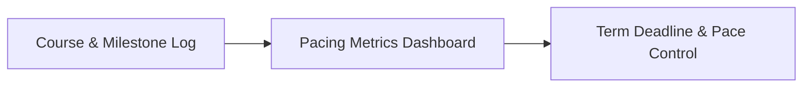
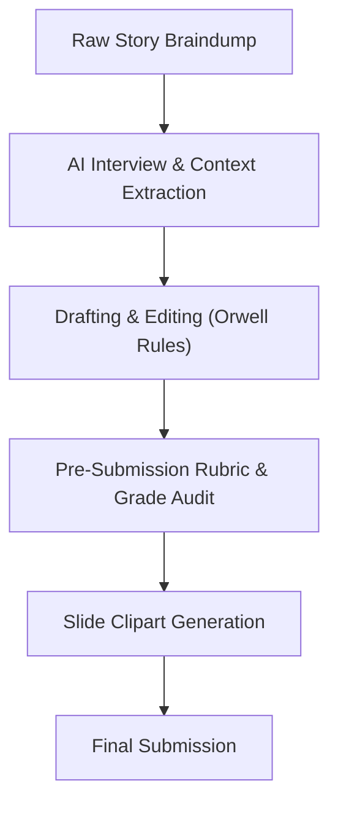

# UMPI YourPace Course Execution Guide
*A Systematic Blueprint for Navigating, Structuring, and Completing Self-Paced Courses in UMPI YourPace*

---

## Overview & Hard Disclaimer: Who This Guide Is (and Is Not) For

This guide provides a systematic, end-to-end blueprint for navigating, structuring, and rapidly completing coursework in the **UMPI YourPace** Competency-Based Education (CBE) program.

> [!WARNING]
> **CRITICAL REALITY CHECK: CBE IS COMPETENCY VERIFICATION, NOT A SUBSTITUTE FOR EXPERIENCE**  
> Competency-Based Education (CBE) is designed specifically for **experienced adult professionals** who already possess years of real-world operational, managerial, or technical experience across the subjects that make up their degree. At its core, CBE is **competency verification**—it is a mechanism for proving through direct experience that you already possess the knowledge required for an accredited degree.
> 
> * **Why Experience is Mandatory for Written Assignments**: In every written assignment across every single class, professors expect you to relate academic topics directly to authentic, lived workplace experience. If you lack real-world experience, you will be unable to write the quality, nuanced essays that CBE professors are looking for. Instead, your papers will rely entirely on generic course materials, sound detached and mechanical, and likely raise suspicion.
> * **You Are Wasting Your Money If You Lack Experience**: If you are a recent high school graduate, a young adult, or someone without years of real-world work experience, **UMPI YourPace is not appropriate for you, and no amount of execution guides will save you—you are simply wasting your money.**
> * **Recommendation for Inexperienced Students**: If you do not have a solid foundation of real-world work experience to draw upon, I strongly recommend contacting your advisor, withdrawing from YourPace, and enrolling in a traditional classroom/lecture program where foundational concepts are taught step-by-step from scratch.

---

## About the Author

Hi! My name is **Christopher Thompson** (known on Discord and Reddit as **`Bigcjat`**).

### My Journey Through UMPI YourPace
I initially set out to earn a Bachelor of Liberal Studies (BLS) through UMPI YourPace simply to satisfy a visa requirement. Shortly after starting, a classmate challenged me to tackle the full **Bachelor of Business Administration (BBA)** instead. At first, I obsessed over the idea that it was impossible—it required 19 university courses instead of 10. 

However, as I built and refined the systematic execution method detailed in this guide, I found that not only was it possible, but I finished the entire BBA with time left over in the term and several multi-day breaks along the way. 

I am currently pursuing my **Master of Arts in Organizational Leadership (MAOL)** through UMPI YourPace at a much more relaxed, comfortable pace because I simply execute the exact execution system outlined here. Following the MAOL, my plan is to continue into the **MS in Business Intelligence**.

### Professional & Background Context
* **Oil & Gas Operations**: 20 years in the oil and gas industry, including 11 years as an operational field foreman for a producer on the British Columbia / Northwest Territories border in Canada.
* **Software Engineering & Tech**: Developer in JavaScript, Python, and PHP for ~25 years. I first went to college in 2001 for a Network Diploma specializing in Windows 2000 and worked briefly at Yahoo!.
* **Location & Lifestyle**: I currently live in Asia, traveling between Tokyo, Singapore, Hanoi, Taiwan, and South Korea. I have visited Japan 13 times so far and plan to settle there permanently.

---

## Part 1: Degree Planning & Transfer Credit Optimization

> [!IMPORTANT]
> **Scope Disclaimer: This is NOT a Transfer Credit Guide**  
> This guide is strictly focused on the **UMPI YourPace course execution workflow**. It assumes you have already maximized all possible third-party transfer credits (Sophia, Study.com, StraighterLine, Coursera) prior to starting your residency at UMPI.  
> 
> **Do NOT Trust Google, ChatGPT, or AI for Degree Planning**: Transfer equivalencies, General Education Curriculum (GEC) rules, and course residency requirements change frequently. Relying on outdated blog posts, random Google searches, or AI chatbots to build your degree plan will leave you with missing prerequisites, unfulfilled requirements, and unexpected gaps in your plan.

Before starting your UMPI YourPace term, maximize your transfer credits to minimize cost and time spent in residency. 

### Leveraging Free Resources: Plotted Path
* **Free Degree Planning Resource**: Visit **[plottedpath.com/free](https://www.plottedpath.com/free)** for comprehensive, up-to-date transfer equivalency charts and General Education (GEC) mapping sheets specifically for UMPI YourPace.
* **Transfer Provider Mapping**: Plotted Path maintains exact equivalency breakdowns showing which courses transfer into UMPI YourPace degree programs from third-party platforms (**Sophia, Study.com, StraighterLine, Coursera**) versus which courses are **UMPI Only**.
* **Community Guidance**: The creator of Plotted Path (`whimsicalone` / Plotted Path ✨) is active in the UMPI YourPace student Discord community, regularly answering student questions on course planning and minor combinations.
* **Custom Degree Plans**: For students with complex prior credits or specific timeline targets, Plotted Path offers personalized, custom degree mapping services for a fee—well worth the investment to optimize your transfer strategy before enrolling.

---

## Part 2: Proactive Professor Selection & Community Research

One of the single most effective strategies in UMPI YourPace is spending **10 minutes researching and requesting specific professors** before adding a course. 

While core assignment prompts and rubrics remain identical regardless of who teaches the class, professor grading turnaround speed, feedback depth, and evaluation style vary significantly. Selecting a professor who aligns with your pace and communication style can save days of waiting time per course.

### 1. Leverage Community Reviews (Discord & Reddit)

> [!TIP]
> **Professor Selection Hack**: Content is standardized across all sections, but securing a professor who grades efficiently keeps your momentum going without administrative bottlenecks. Before requesting a section, check student feedback:
> * **[UMPI Student Discord Community](https://discord.gg/P6HnsZ8CdQ)**: Access dedicated review channels:
>   * **`#professor-reviews`**: Read feedback on grading turnaround times (e.g., 24-hour graders vs. multi-day turnaround), accommodating communication, and grading fairness.
>   * **`#class-reviews`**: Review overall course difficulty, number of milestone activities, and specific professor recommendations for that exact class.
> * **[r/UMPI Subreddit](https://www.reddit.com/r/UMPI/)**: Search the official student subreddit for course completion reports, transfer strategies, professor insights, and degree planning advice.

---

### 2. How to Lookup Available Professors (MaineStreet Class Search)

Follow these exact steps to see which professors are teaching upcoming UMPI YourPace course sections:

1. Log into **`mycampus.maine.edu`**.
2. Under **Category Links**, click **Mainestreet** $\rightarrow$ **Classic Student Center**.
3. Click the **House icon** at the top right (next to the bell icon).
4. In the top search bar, type **`class search`** (*do NOT press enter*).
5. Click **"Class Search Curriculum Management"** from the pop-up results.
6. Set **Institution** to *University Maine Presque Isle*.
7. Set **Term** to your active term (e.g., *2026 Summer* or *2026 Fall*).
8. Set **Session** to *OnlineMaine Session 01* (YourPace Session 1) or *OnlineMaine Session 02* (YourPace Session 2).
9. Click **Search**. Scroll through the alphabetized course list to inspect active sections and view the assigned professor for each section.

> [!NOTE]
> **Requesting Your Preferred Professor**: When emailing advising (`yourpace@maine.edu`) to add your next competency, explicitly request your preferred professor by name.

---

## Part 3: Macro Level — UMPI YourPace Pacing & Progress Tracker (Spreadsheet System)

While local folders handle individual course files, a **Macro Pacing Spreadsheet** gives you total visibility over your entire UMPI YourPace degree plan, term deadlines, and milestone progress.



Below is the **essential minimum tracking schema** every UMPI YourPace student should maintain:

### Master Pacing Spreadsheet Schema

| Tracking Field | Data Tracked | Operational Rationale |
| :--- | :--- | :--- |
| **1. Course Identifiers** | Course Code (e.g., `BUS 353`), Title, Credit Hours, Platform | Prevents confusion between similar courses (e.g., `BUS 240` vs. `BUS 245` vs. `BUS 415`) and tracks transfer credit sources. |
| **2. Granular Status** | `Started`, `Draft Sent`, `Final Sent`, `Complete`, `Transferred` | Color-coded status fields give an instant visual check of what is active vs. waiting on professor review. |
| **3. Milestone Columns** | Separate columns for `M1`, `M2`, `M3`, `M4`, `M5`, `Final Draft`, `Final` | Identifies the exact bottleneck in any course so you know whether you are waiting on M2 or ready for the Final. |
| **4. Submission Timers** | Submission Timestamp (`Aug 1, 15:08`) & Elapsed Time Calculator | Tracks professor grading windows and alerts you when a submission has exceeded standard turnaround times. |
| **5. Term Clock Metrics** | Days Elapsed vs. Days Remaining in current 8-week term | Seeing **"27 Days Remaining"** alongside **"4 Courses Left"** calculates required pace (e.g., 6.7 days/course). |
| **6. Hard Cutoff Dates** | Course Add Cutoff, Milestone Cutoff, Final Submission Cutoff | Prevents missing administrative deadlines that block unlocking your next course section. |
| **7. Professor Notes** | Grading velocity (*"Grades in 24 hrs"* vs. *"Takes 3 days"*) | Allows strategic submission sequencing—submitting to a fast grader right before a weekend eliminates downtime. |

---

## Part 4: Micro Level — Course Workspace Architecture & Organization

By adopting a **Clean Module Directory Architecture**, you keep your thoughts organized, reduce cognitive friction, and eliminate wasted time hunting for misplaced files.

### Standardized Course Directory Structure

For every course, create a dedicated directory structured as follows:

```text
/Course_Name (e.g., OLS 500 Data Driven)
├── sources.txt                 <-- Central master stash of all citations & APA 7 references
├── mod 1/                      <-- Module 1 folder
│   ├── mod1.txt                <-- Local plain-text copy of assignment prompt & rubric
│   ├── course materials/       <-- PDFs, readings, articles, & textbook chapters for Mod 1
│   ├── srts/                   <-- Downloaded .srt video subtitle files for Mod 1
│   ├── Milestone_1.txt         <-- Working draft file for Milestone 1
│   └── Milestone_1.docx        <-- Final formatted submission file
├── mod 2/                      <-- Module 2 folder
│   ├── mod2.txt                <-- Local plain-text copy of assignment prompt & rubric
│   ├── course materials/       <-- PDFs, readings, articles, & textbook chapters for Mod 2
│   ├── srts/                   <-- Downloaded .srt video subtitle files for Mod 2
│   ├── Milestone_2.txt         <-- Working draft file for Milestone 2
│   └── Milestone_2.docx        <-- Final formatted submission file
└── final/                      <-- Final Assessment folder
    ├── Final_Submission.txt    <-- Working draft file for Final Assessment
    └── Final_Submission.docx   <-- Final formatted submission file
```

---

### Key Directory Protocols

> [!NOTE]
> **1. The "Prompt Inoculation" Method (`modX.txt`)**  
> Before typing a single word of a draft, copy the exact assignment prompt and rubric criteria from Brightspace into a local plain-text file (`mod1.txt`, `mod2.txt`). Your prompt criteria sit right next to your draft so you never switch tabs or hunt for rubrics while writing.

> [!NOTE]
> **2. Sub-Folder Organization: `course materials/` & `srts/`**  
> * **`course materials/`**: Holds all downloaded course PDFs, articles, reading assignments, and textbook chapters for that module.  
> * **`srts/`**: Holds all downloaded `.srt` video subtitle transcript files for that module's video lectures.

---

### Mandatory APA 7 Standard & Drafting Strategy

> [!IMPORTANT]
> **Mandatory APA 7 Standard (Stop Wasting Time Asking)**  
> * **Every Single Document is APA 7**: A common point of confusion among new UMPI students on Discord and Reddit is asking whether a specific milestone or final assignment requires APA 7 formatting. **Yes, it does — every single document submitted at UMPI YourPace requires APA 7 formatting.** Stop wasting time asking; simply treat APA 7 as the non-negotiable default for every paper, essay, and milestone across all courses.
> * **Gold-Standard APA 7 Reference**: Reference the official **[Purdue OWL APA 7 Formatting & Style Guide](https://owl.purdue.edu/owl/research_and_citation/apa_style/apa_formatting_and_style_guide/apa_sample_paper.html)** for sample papers, title page setups, in-text citations, and reference list formatting.

> [!TIP]
> **Plain-Text First Drafting Strategy (`.txt` to `.docx`)**  
> Some students prefer building pre-formatted Microsoft Word templates (`12 pt Times New Roman, double-spaced`) upfront. Personally, I hate writing inside double-spaced 12 pt Times New Roman from scratch—it slows down my train of thought.
> 
> * **Draft in Plain Text First**: Write all working drafts in simple plain-text (`.txt`). Drafting in plain text forces you to focus 100% on argument flow, thesis depth, and source citations without getting distracted by Word line spacing, font dropdowns, or margins.
> * **The Rapid Polishing Pass**: Once the draft is complete, copy the plain text into Microsoft Word and format it into APA 7 right before submitting. With practice, you get significantly faster—you can take an unformatted plain-text draft and turn it into a polished APA 7 document in just a few minutes. 
> * **The Hidden Benefit**: This final formatting pass forces you to read through your entire paper line-by-line one more time, catching typos, passive voice, and weak transitions right before submission.
> * **Do Whatever Works for You**: Whether you prefer starting from a Word template or using the plain-text-first method, choose whatever is easiest for you—just remember to stick strictly to APA 7 for every single document!

> [!TIP]
> **Automated Citation & Reference Management (Zotero)**  
> To automate collecting research papers, organizing citations, and building instant APA 7 reference lists across all your courses, install **[Zotero](https://www.zotero.org/)** (a free, open-source reference manager).
> 
> * **Degree Strategy Tutorial**: For a complete step-by-step walkthrough on setting up Zotero for UMPI courses, watch **[How to Use Zotero for Fast Academic Research](https://www.youtube.com/watch?v=fHQtAodgNrQ)** by **Melanie** from the **Degree Strategy** channel (a UMPI Bachelor's and Master's graduate). Her guide shows how to save web articles/PDFs with one click and auto-export formatted APA 7 citations straight into your papers.

> [!IMPORTANT]
> **Always Submit a Final Draft First (Never "YOLO" Your Final Assessment)**  
> Another constant point of confusion on Discord is students skipping draft submissions or ignoring professor feedback. Follow these non-negotiable submission rules:
> * **Always Submit a Draft First**: Never bypass the draft submission step for your Final Assessment.
> * **Address Every Bit of Feedback**: Unless your professor explicitly tells you to submit your draft directly as your final (meaning you scored perfect marks), **always address every single piece of feedback** before submitting the final version.
> * **Draft Scores Do NOT Guarantee Final Grades**: Even if you don't care about Latin Honors or perfect scores, receiving a 3/4 on a draft criterion does *not* guarantee a 3/4 if you re-submit it unedited as your final. Professors expect active revisions.
> * **Never "YOLO" a Final Essay**: Do not get cocky and submit a final without getting draft feedback first. Bypassing the feedback loop could annoy a professor, and your final score will likely reflect it. Just don't do it.

---

## Part 5: The Core Human Execution System (Non-AI Workflow)

### Step 1: Syllabus & Professor Contact Setup

Before writing a single sentence, open the **Syllabus / Welcome tab** in your Brightspace portal and read it from top to bottom.

> [!TIP]
> **Locate Professor Contact Information Immediately**: The Syllabus tab is the central hub containing your professor's **direct email address** and often an **urgent phone/text number** (e.g., *"Feel free to text 207-XXX-XXXX"*). Copy this contact info into your `sources.txt` or `mod1.txt` file on Day 1.

* **Map the Course Arc**: Identify every milestone assignment, knowledge check, and the final project/essay requirement upfront.
* **Select an Overarching Topic Early**: Pick a single, robust research topic or real-world operational scenario during Module 1 that can thread directly through every milestone into the final project.
* **Cumulative Stacking (Building the Final as You Go)**: Re-using a consistent operational theme means Milestones 1–5 serve as building blocks. By the time you reach the Final Assessment, 70% of your research, references, and core arguments are already written.

---

### Step 2: Source Extraction & Video Subtitles

Maximize learning and eliminate note-taking during lectures.

* **Watch Assigned Videos for Deep Context**: Video lectures and talks provide far richer context and better conceptual understanding than dry textbook readings alone. Watch them to absorb the core ideas.
* **Download Video Subtitles (`.srt`) into `mod X/srts/`**: Use free transcript tools (e.g., DownSub) to download the `.srt` subtitle files for every course video directly into that module's `srts/` folder.
* **Save Readings into `mod X/course materials/`**: Save all PDF articles, chapters, and required readings into the module's `course materials/` folder.
* **Zero Note-Taking While Watching**: Do not pause videos to write manual notes. Sit back and focus entirely on watching and understanding the material. The `.srt` files in your `srts/` folder serve as your complete, word-for-word transcript, allowing you to search for exact quotes, timestamps, and key terms later when drafting your assignments.
* **Centralize Citations in `sources.txt`**: Use `sources.txt` at the root of the course folder strictly to stash master APA 7 bibliographic citations for all readings and videos.

---

### Step 3: The Lived-Experience Braindump

Academic essays backed only by textbook summaries sound generic. Ground your work in real experience.

1. **Write a Raw Operational Story**: Spend 10–15 minutes braindumping a real workplace scenario, project, or operational problem you have managed.
2. **Focus on Concrete Details**: Include specific tools, safety rules, regulatory mandates, budget approvals, or operational constraints.
3. **No Formatting Required**: Do not worry about grammar or academic structure during the braindump—focus strictly on capturing authentic operational facts.

---

### Step 4: The 8-Source Reference Selection System

Instead of randomly picking references, follow this exact **8-Source Formula** for every major essay to guarantee full rubric coverage and complete citation support:

### The 8-Source Formula

| Source Slot | Source Type | Storage Location | Operational Purpose |
| :--- | :--- | :--- | :--- |
| **Source 1** | Primary Anchor Reading | `mod X/course materials/` | Baseline foundation for the module's core arguments. |
| **Source 2** | Core Conceptual Support | `mod X/course materials/` | Directly supports your essay's specific operational scenario. |
| **Sources 3–6** | Targeted Gap Fillers | Peer-Reviewed Journals | Fills remaining rubric requirements & statistical proof. |
| **Sources 7–8** | Video Lecture Transcripts | `mod X/srts/` | Provides timestamped verbatim quotes from course videos. |

> [!NOTE]
> **Why it works**: Having exactly 8 targeted sources guarantees every single concept in your essay is cited, satisfies professor expectations for academic depth, and prevents last-minute scrambling for references.

---

### Step 5: Plain English Writing & Orwell’s 6 Rules

Avoid pompous academic jargon and artificial filler. Apply George Orwell's classic plain-English rules (*"Politics and the English Language"*):

1. **Never use a metaphor, simile, or figure of speech** you are used to seeing in print.
2. **Never use a long word** where a short one will do.
3. **If it is possible to cut a word out**, always cut it out.
4. **Never use the passive voice** where you can use the active voice (*"We managed the site"* vs *"The site was managed by us"*).
5. **Never use a foreign phrase, scientific term, or jargon word** if you can think of an everyday English equivalent.
6. **Break any of these rules** sooner than say anything outright barbarous.

---

## Part 6: Responsible & Authorized AI Integration

If your institution and course policy explicitly permit AI assistance, use AI strictly as a force multiplier for preparation, feedback, and visual assets—not as a substitute for authentic human experience.



---

### 1. Interactive Context Interviews (Refining Your Braindump)

Instead of asking AI to write for you, use AI as an interviewer to extract missing operational context.

* **The Setup**: Feed your raw story braindump to the AI alongside the course rubric.
* **The Directive**: Instruct the AI to act as a senior project manager or academic interviewer and ask you 3–5 targeted questions about missing metrics, policy details, or operational steps needed to align your story with the rubric criteria.

```markdown
Act as a senior project manager and academic interviewer. Review my raw operational braindump alongside this rubric. Ask me 3 to 5 targeted questions about missing metrics, safety policies, or operational constraints needed to fully satisfy the rubric criteria. Do not write the paper for me; simply ask the clarifying questions.
```

---

### 2. Automated Rubric & Professor Grading Simulation

Get an objective pre-submission audit before handing in your work.

* **The Inputs**:
  1. The full assignment prompt and rubric criteria (`modX.txt`).
  2. Past feedback your professor has given on previous assignments.
  3. Student review insights or known professor grading preferences.
  4. Your completed draft (`Milestone_X.txt`).
* **The Directive**: Ask the AI to grade your draft strictly against the rubric, highlight any missing criteria or formatting errors, and estimate your score category (*Exemplary, Proficient, Developing*).

---

### 3. Presentation Asset Generation (Minimalist Slide Clipart)

When creating presentation slides for milestone assignments, generate custom visual assets that maintain clean, professional focus.

* **Visual Style**: Classic 90s-style minimalist clipart (MS Office 97/2000 aesthetic).
* **Composition Rules**:
  * Focus on **one single clear subject or scene** (e.g., 1–2 people working or 1 key object).
  * **Zero floating extra icons**, zero background clutter, zero random lightbulbs/gears.
  * **No text, words, lettering, or numbers** embedded in the image.
* **Integration**: Insert the clean clipart into your PowerPoint/Keynote slides and embed your presentation script word-for-word into the **Speaker Notes** section of each slide.

> [!TIP]
> **Slide Design Hack (PDF-to-PowerPoint Conversion)**:  
> If designing directly inside PowerPoint feels clunky or frustrating, you don't have to build slides from scratch in PowerPoint. You can design your slide layout in whatever software you are most comfortable with (including Microsoft Word, Google Docs, or Canva), save or "print" the file as a PDF, and then convert the PDF directly into a `.pptx` PowerPoint presentation.

---

### 4. Cameo Video Recording & Presentation Confidence

For courses that require a video presentation (Cameo recordings), keep these critical strategies in mind:

> [!TIP]
> **Research Professor Audience Requirements**: While there is no way around recording Cameo videos, some professors strictly require a live audience in the video while others are flexible. Research professor reviews in the student Discord (`#professor-reviews`) to find professors who accommodate individual needs.

* **Camera Confidence & Grading Reality**: If you feel nervous recording yourself, remember that **only your professor will see your video**. Wear something nice, speak clearly, and realize that for the vast majority of courses, you are being evaluated on content mastery—not public speaking skills.
* **The Hand-Anchor Hack (Bluetooth Mic)**: The single best practical tip for recording is to pick up a **DJI Bluetooth microphone** (or similar wireless mic). The main benefit isn't just audio quality—it's giving your hands a physical job to do. Hold the microphone body in one hand while using your other hand to scroll through your speaker notes. Giving your hands a physical task eliminates awkward fidgeting, grounds your body, and noticeably boosts your confidence and focus while recording.

---

## Part 7: Student Mindset, Motivation & Burnout Strategies

Self-paced UMPI YourPace programs offer unmatched flexibility, but they demand internal discipline. Maintaining the right psychological perspective and humor is essential to keeping your momentum high.

> [!NOTE]
> **The 10-Minute Burnout Prevention Rule**: If you hit a mental wall while writing, set a timer for 10 minutes. Tell yourself you only have to work for 10 minutes. If you still feel completely drained when the timer rings, close your laptop and step away for the day without guilt. 90% of the time, simply crossing the 10-minute starting threshold breaks through procrastination and gets your momentum flowing again.
